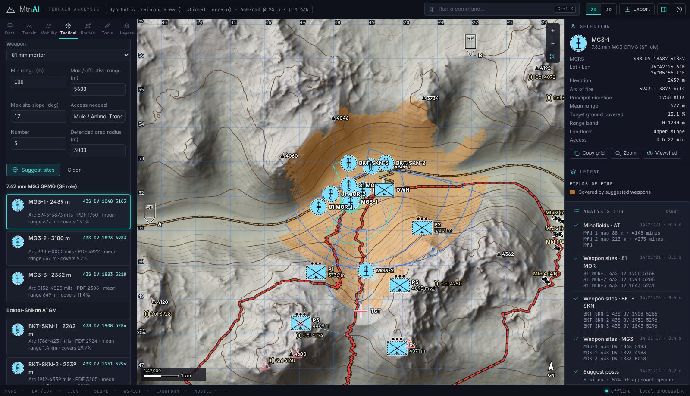
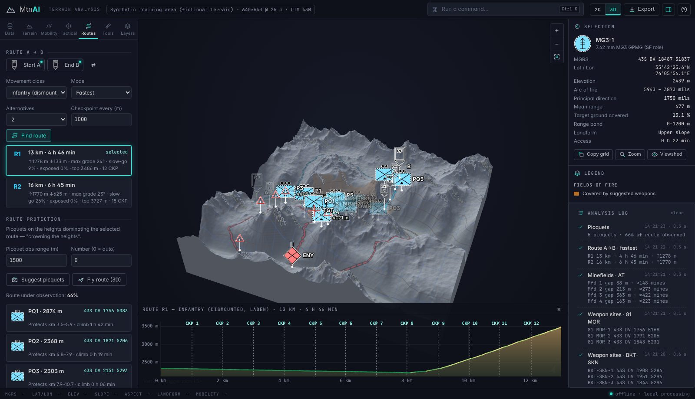

# MtnAI — Mountain Terrain Analysis

A lightweight, **fully offline** GIS decision aid for planning operations in mountain terrain.
MtnAI reads a digital elevation model (DEM), derives slope, aspect, landforms and cross-country
mobility, and then suggests **posts / OPs, weapon sites, minefields (Mfd) and routes** from
the terrain. It shows the results on a 2D map and on a 3D terrain model using **NATO APP-6(D) /
MIL-STD-2525D** symbology, with Pakistan Army weapon data built in.

There is no installation, no server and no network access. Everything runs in the browser on the
user's own machine.




## Features

| Requirement | What MtnAI does |
|---|---|
| **Terrain analysis** | Slope (Horn), aspect, multi-directional hillshade, TPI landforms (valley → ridge, military-crest zone), ruggedness (TRI), contours, MGRS 1 km grid, hypsometry / slope / aspect statistics. Also detects **dominating heights** and **passes / cols**. |
| **Go / No-Go areas** | GO / SLOW-GO / NO-GO per movement class: dismounted infantry, mule / animal transport, jeep, truck / towed gun, tracked. Slope thresholds are editable, with an optional snow line. Digitised No-Go areas (rivers, glaciers, built-up) and tracks are respected. Shown as colour fill or doctrinal hatching. |
| **Best locations for posts** | Greedy maximum-coverage viewshed analysis of likely enemy movement ground (weighted towards the enemy approach corridor and avenues of approach). Reports coverage, **dead ground**, intervisibility between posts and foot access time. |
| **Best weapon sites** | *Direct fire* (MG3, 12.7 mm HMG, RPG-7, 106 mm RCL, Baktar-Shikan, TOW): fields of fire inside the weapon's range band, rewarding enfilade, with arc of fire (L/R) and principal direction in mils. *Indirect fire* (60/81/120 mm mortars, 105 mm pack howitzer, 122 mm, 130 mm gun, 155 mm): positions behind own troops, hidden from enemy observation, flat ground, access, and a **crest-clearance** check with quadrant elevation (high / low angle). *Air defence* (Anza Mk-II/III, 35 mm GDF): cover of valley flight corridors at 100 m above ground. |
| **Best Mfd locations** | AT / AP minefields at the **narrowest defiles on enemy avenues of approach**, tied into No-Go ground and inside reach of own troops. Flags whether each field is observed / covered by fire. Gives the front, depth, gap width and an estimated mine count. |
| **Best routes A → B** | Anisotropic least-time A* (Tobler's hiking function for foot / mule, slope-limited vehicles, altitude penalty) in three modes: *fastest*, *balanced* and *covered* (avoids enemy observation and skylines). Gives alternatives, checkpoints, an elevation profile, time / ascent / exposure, **picquets** to crown the heights along the route, and a 3D fly-through. |

Also included:

- Enemy observation (defilade) analysis.
- Enemy avenues of approach.
- Line of sight with terrain profile.
- Viewsheds.
- Distance and bearing in mils.
- Go-to MGRS.
- Command palette (<kbd>Ctrl</kbd>+<kbd>K</kbd>) and an analysis log.
- Exports:
  - GeoJSON with 2525D SIDCs, for other GIS / C2 tools.
  - ESRI ASCII grid + `.prj`.
  - PNG.
  - Plan save / load.
  - Printable terrain-assessment report.

## Running it (offline)

Choose one of these:

1. **Single file:** copy `dist/MtnAI.html` (~340 KB) to any computer and double-click it.
2. **From the folder:** open `index.html` directly from disk (`file://`).
3. **Optional local server:** `npm start` (Python `http.server`), then browse to http://localhost:8080.

Use a current Chrome, Edge or Firefox. The 3D view needs WebGL2. Heavy analysis runs in a Web
Worker, so the interface stays responsive.

Click **Demo terrain** to load the synthetic training area. It is fictional Karakoram-style
terrain with own / enemy positions, a target area on a pass, and valley and mule tracks already
placed. Then work through the tabs.

## Elevation data

| Format | Notes |
|---|---|
| SRTM `.hgt` (1″ or 3″) | Tile origin comes from the file name (`N35E074.hgt`). Load several tiles at once to mosaic them. Voids are filled. |
| GeoTIFF `.tif` | Uncompressed, LZW, Deflate or PackBits; predictors 1/2/3; strips or tiles; EPSG:4326, WGS 84 / UTM (326xx/327xx) or EPSG:3857. Covers e.g. Copernicus GLO-30, ALOS AW3D30, ASTER GDEM. |
| ESRI ASCII `.asc` | Geographic, or projected UTM (set the zone in the Data tab). |
| `.zip` | Any of the above inside a ZIP archive. |

Download the tiles for your area once (for example SRTM / Copernicus DEM from USGS EarthExplorer
or OpenTopography) and keep them on the laptop. If your DEM uses another projection, convert it
first, for example `gdalwarp -t_srs EPSG:4326 in.tif out.tif`.

Data is resampled into one square-cell **UTM** grid (up to 1536² cells). Use **Crop to AOI** to
analyse a sector at the native resolution.

## Method (OAKOC)

- **Observation & fields of fire.** Radial-sweep viewsheds with earth curvature and refraction
  (k = 0.13). Sites are chosen by greedy maximum coverage of weighted target ground, with
  minimum-separation and overlap discounts.
- **Avenues of approach.** Three alternative least-time paths for the enemy's movement class,
  from the enemy to own position.
- **Key terrain.** Dominating heights come from large-scale topographic position. Cols are found
  with a ring sign-change saddle test.
- **Obstacles.** NO-GO comes from slope plus digitised features. Minefields go where the passable
  corridor across an avenue is narrowest, measured in eight directions.
- **Cover & concealment.** Likely enemy OPs (high ground near the enemy) drive defilade for
  mortars / guns and the "covered" route cost.
- **Crest clearance.** A vacuum trajectory with an effective muzzle velocity calibrated to the
  weapon's maximum range, using the weapon's elevation limits. This is an *indicative* screen,
  not a firing solution.

## Movement classes (editable)

| Class | GO | SLOW-GO | NO-GO |
|---|---|---|---|
| Infantry (dismounted, laden) | ≤ 20° | ≤ 40° | > 40° |
| Mule / Animal Transport | ≤ 15° | ≤ 25° | > 25° |
| Light vehicle (jeep / 4×4) | ≤ 10° | ≤ 20° | > 20° |
| Truck / towed gun | ≤ 6° | ≤ 12° | > 12° |
| Tracked (tank / APC) | ≤ 15° | ≤ 30° | > 30° |

## Weapons (indicative open-source ranges, editable per run)

| Weapon | Group | Range band |
|---|---|---|
| 7.62 mm MG3 (SF role) | Direct, anti-personnel | 0–1,200 m |
| 12.7 mm HMG (Type 54 / W-85) | Direct, anti-personnel | 0–1,600 m |
| RPG-7 | Direct, anti-armour | 30–300 m |
| 106 mm RCL (M40) | Direct, anti-armour | 50–1,100 m |
| Baktar-Shikan ATGM | Direct, anti-armour | 100–3,000 m |
| TOW-2A ATGM | Direct, anti-armour | 65–3,750 m |
| 60 / 81 / 120 mm mortars | Indirect (high angle) | up to 2.5 / 5.6 / 7.2 km |
| 105 mm M56 pack howitzer | Indirect | 1–10.5 km |
| 122 mm Type 54-1 howitzer | Indirect | 2–11.8 km |
| 130 mm Type 59-1 field gun | Indirect (low angle) | 3–27 km |
| 155 mm M198 howitzer | Indirect | 2.5–22.4 km |
| Anza Mk-II / Mk-III MANPADS | Air defence | 0.5–5 / 6 km |
| 35 mm Oerlikon GDF | Air defence | 0–4 km |

Always confirm these figures against current unit data.

## NATO symbology

Symbols are drawn by a small built-in APP-6(D) / MIL-STD-2525D renderer:

- **Frames:** friend, hostile, neutral and unknown. Planned positions use dashed frames.
- **Amplifiers:** echelon amplifiers and the mountain modifier.
- **Equipment icons:** with range bars.
- **Control measures:** OP, SP, RP, checkpoint, target reference point, AT / AP mines.

GeoJSON exports carry the matching 20-digit SIDC for each feature.

## Project layout

```
index.html            app shell (opens directly from disk)
css/app.css           "Nautilus Dark" theme
src/core/             analysis library — runs in the Web Worker, main thread and Node
  geo.js grid.js terrain.js mobility.js visibility.js routing.js weapons.js tactical.js synthetic.js jobs.js
src/io/dem-io.js      HGT / GeoTIFF / ASC / ZIP readers and UTM resampling
src/ui/               2D map, WebGL2 3D view, NATO symbols, charts, export, app controller
tools/build.mjs       single-file offline build → dist/MtnAI.html
tools/e2e-smoke.cjs   browser smoke test (Playwright)
test/                 unit tests (node:test)
```

There are no runtime dependencies. The worker is built from the core modules' own source, so it
also works from `file://`.

## Development

```
npm test            # unit tests: geodesy/MGRS, terrain, viewshed, routing, crest clearance, importers, tactics
npm run build       # regenerate dist/MtnAI.html
npm run e2e         # browser smoke test (needs Playwright + Chromium)
```

## Limitations

- Results are only as good as the DEM. A 30 m SRTM model smooths cliffs, narrow nullahs and
  small features.
- Vegetation, snow, soil, water, built-up areas and enemy dispositions are not modelled unless
  digitised.
- Every suggestion is a planning aid to focus reconnaissance. It does not replace ground
  reconnaissance, current unit weapon data or commander's judgement.

## Credits

Symbol frame and icon geometry follows APP-6(D) / MIL-STD-2525D as implemented in the
MIT-licensed [milsymbol](https://github.com/spatialillusions/milsymbol) library (© Måns Beckman).
No milsymbol code is bundled.
